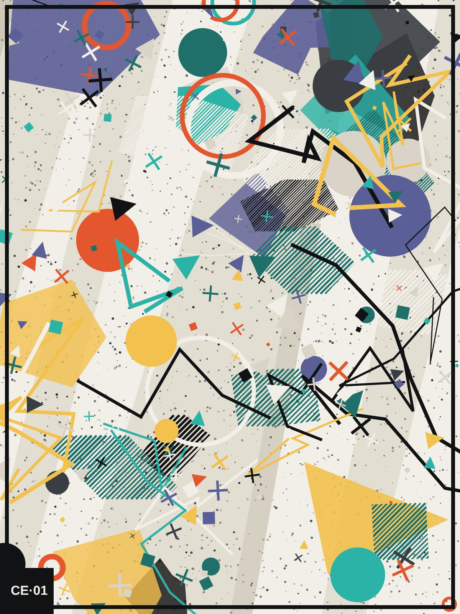

# WebAR · Arte Expandida — Entrega 1 (POC)

Prova de conceito web (sem instalar app): a câmera do celular reconhece uma **obra física original impressa** e sobrepõe **três elementos 3D** alinhados à superfície — uma forma flutuante, um anel em rotação e partículas. Acesso por link/QR Code, HTTPS.

> Status: POC implementada e validada em navegador automatizado (ver [Validação](#validação)). **QA em iPhone e Android reais: PENDENTE** — ver [`tests/smoke-checklist.md`](tests/smoke-checklist.md).



## Como testar no celular

1. Abra `/imprimir.html` no site publicado (folha A4 com a obra + QR Code da experiência) e imprima em **papel fosco**, escala 100%. Ou imprima [`public/images/obra-original.png`](public/images/obra-original.png) em A4 ou maior, sem cortar bordas. (Também funciona apontando para a imagem aberta numa tela, com menos estabilidade por causa de reflexo/moiré.)
2. Abra a URL HTTPS publicada (ou leia o QR Code) no **Safari (iPhone)** ou **Chrome (Android)**.
3. Toque em **Iniciar experiência**, permita a câmera e enquadre a obra inteira a ~30–60 cm.
4. Sem câmera? **Ver demonstração sem câmera** mostra os efeitos sobre a obra em 3D.

No computador, a tela inicial mostra um QR Code para continuar no celular.

Adicione `?debug=1` à URL para ver FPS e o contorno de registro do alvo (útil para avaliar jitter).

## Rodar localmente

Requisitos: Node 22.12+ (testado com Node 22.22.0 / npm 10.9.4).

```bash
npm ci
npm run dev          # http://localhost:5173 (localhost já é contexto seguro p/ câmera no desktop)
npm run dev:https    # https://<ip-da-rede>:5173 com certificado autoassinado, para abrir no celular
npm run build        # typecheck + build de produção em dist/
npm run preview      # serve dist/ com os mesmos cabeçalhos (CSP) de produção
```

No celular via `dev:https`, aceite o aviso de certificado (iOS: "Mostrar detalhes › visitar este site").

## Scripts

| Comando | O que faz |
| --- | --- |
| `npm run typecheck` | `tsc --noEmit` (modo strict) |
| `npm test` | testes unitários (Vitest) |
| `npm run build` | typecheck + `vite build` |
| `npm run art` | regenera a arte original (determinística, seed 2026) em `public/images/` |
| `npm run target` | compila a imagem em `public/targets/obra-original.mind` com o compilador do próprio MindAR (Chromium headless) |
| `npm run test:e2e` | teste ponta a ponta com câmera simulada (requer `npm run build`, ffmpeg e Playwright) |

`art`, `target` e `test:e2e` usam Playwright (Chromium). Se não estiver instalado: `npm i -D playwright && npx playwright install chromium`.

## Estrutura

```
public/
  images/obra-original.{svg,png,jpg}   arte-alvo original (CC BY 4.0, ver ART_LICENSE.md)
  targets/obra-original.mind           alvo compilado (MindAR 1.2.5)
  models/                              reservado para GLB/GLTF (efeitos atuais são procedurais)
src/
  ar/engine.ts            interface do motor de rastreamento (troca futura de SDK)
  ar/mindarEngine.ts      implementação com MindAR Controller
  ar/camera.ts            getUserMedia, classificação de erros, encerramento de tracks
  ar/trackingState.ts     máquina de estados (loading/scanning/found/lost/error)
  ar/createExperience.ts  cena Three.js, âncora, loop, resize/rotação, desmontagem; modo demo
  effects/createFloatingShapes.ts   os três efeitos 3D
  ui/StatusOverlay.ts     HUD, dicas, loading, telas de erro
  ui/qr.ts                QR Code (carregado sob demanda)
  styles/main.css, print.css
  main.ts                 telas e fluxo
  print.ts                página imprimir.html (obra + QR em A4)
scripts/   generate-art.mjs, compile-target.mjs, compile-target.md
tests/     smoke-checklist.md (QA físico), e2e/tracking.e2e.mjs (automatizado)
docs/      ARQUITETURA.md (decisões, riscos, compatibilidade), BACKLOG.md
```

## Versões fixadas

| Pacote | Versão | Observação |
| --- | --- | --- |
| mind-ar | 1.2.5 | image tracking; usamos o `Controller` de baixo nível |
| three | 0.186.1 | `MindARThree` do pacote **não** é compatível (importa `sRGBEncoding`, removido na r162) |
| vite | 7.3.7 | |
| typescript | 5.9.3 | |

`mind-ar` declara a dependência nativa `canvas` (node-canvas), usada só pelo compilador em Node. Ela é substituída por um stub vazio via `overrides` (`stubs/canvas`), evitando compilação nativa (que falha em vários ambientes). Não afeta o navegador.

## Deploy (Vercel)

`vercel.json` já define build (`npm run build`), saída (`dist`) e cabeçalhos de segurança (CSP, Permissions-Policy só com câmera, HSTS, cache). Importar o repositório na Vercel é suficiente. Netlify/outros: publicar `dist/` com HTTPS e replicar os cabeçalhos.

Alternativa: `.github/workflows/pages.yml` publica no GitHub Pages sob demanda — habilite *Settings › Pages › Source: GitHub Actions* e rode *Actions › Deploy GitHub Pages › Run workflow*. O Pages não aplica os cabeçalhos de segurança.

## Privacidade

A câmera é processada **localmente** (TensorFlow.js/WebGL no navegador). Nenhum quadro é gravado, enviado ou armazenado; não há analytics nem chaves no bundle. A câmera só é solicitada após toque em "Iniciar experiência" e é encerrada ao sair, ao trocar de página ou ao fechar.

## Troubleshooting

| Sintoma | Causa provável / solução |
| --- | --- |
| "Conexão não segura" | Página aberta via `http://` fora de localhost. Use HTTPS (`npm run dev:https` ou deploy). |
| iOS: câmera não abre dentro do Instagram/WhatsApp | Navegadores embutidos limitam câmera. Abra no Safari. |
| iOS: permissão negada uma vez e não pergunta mais | `aA` › Ajustes do Site › Câmera › Permitir; ou Ajustes › Safari › Câmera. |
| Android: permissão bloqueada | Cadeado na barra › Permissões › Câmera. Verifique também a permissão do Chrome no Android. |
| Fica em "Procurando a obra…" | Enquadre a obra inteira; mais luz; evite reflexo; impressão pequena demais (< A5) dificulta. |
| Elementos tremem | Segure firme; luz melhor; ajustar `filterMinCF`/`filterBeta` em `src/ar/mindarEngine.ts` após medições. |
| Primeira abertura lenta | O motor (≈ 280 KB gzip) e o alvo (≈ 930 KB) baixam ao iniciar; depois ficam em cache. |
| Tela de "Falha no reconhecimento" | WebGL instável/sem memória. Feche abas; tente outro navegador. |

## Validação

Ver relatório e evidências em [`docs/ARQUITETURA.md`](docs/ARQUITETURA.md#validação-executada) e [`tests/smoke-checklist.md`](tests/smoke-checklist.md).
